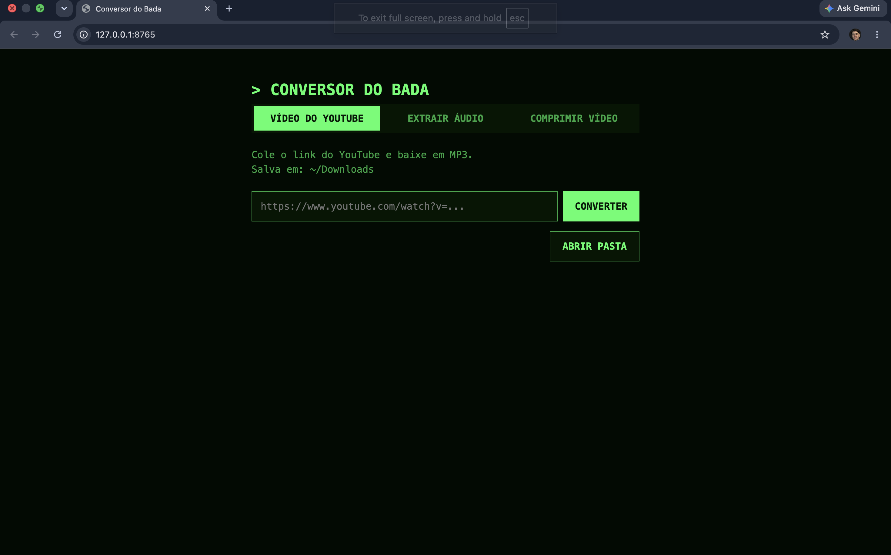

# Conversor do Bada

Fiquei cansado de ver tanto anúncio e ter um trilhão de sites pra converter tudo, então juntei tudo em um que roda na sua própria máquina.

Ele tem 3 funcionalidades:
- [Baixar vídeo do YouTube em MP3](#baixar-vídeo-do-youtube-em-mp3)
- [Extrair áudio de um vídeo](#extrair-áudio-de-um-vídeo)
- [Comprimir vídeo](#comprimir-vídeo)

## Como rodar

### Mac
- Abrir arquivo: **`Abrir Conversor.command`**

### Windows
- Abrir arquivo: **`Abrir Conversor.bat`**

Um Terminal abre, o servidor sobe e o navegador abre a página. 

Se o servidor já estiver rodando, ele só abre a página.




Pronto! Agora é só aproveitar 🎉🎉🎉

## Detalhes técnicos para nerds

### Rodar pelo terminal

```bash
cd ~/Documents/Coding/conversor-de-video-do-bada
python3 server.py
```

O navegador padrão abre sozinho em http://127.0.0.1:8765. Para parar o servidor, aperte `Ctrl+C` no terminal.

### Dependências

O **Abrir Conversor** instala tudo isso sozinho na primeira vez.

- Python 3 (não precisa instalar nenhuma biblioteca)
- `yt-dlp`, baixa os vídeos do YouTube
- `ffmpeg`, converte para MP3 e comprime vídeo

Se o yt-dlp parar de funcionar, atualize com `brew upgrade yt-dlp` (Mac) ou `winget upgrade yt-dlp` (Windows). O YouTube muda com frequência.

### Baixar vídeo do YouTube em MP3

Cole o link e clique em **Converter**. Ele roda:

```bash
yt-dlp -x --audio-format mp3 "link"
```

O MP3 fica em:
```bash
Downloads/downloads-conversor-do-bada/youtube-para-mp3
```
com o nome do vídeo. 

Para mudar a pasta, edite `OUT_DIR` no `server.py`.

### Extrair áudio de um vídeo

Escolha um arquivo (MP4, MOV...) e clique em **Extrair áudio**. Ele roda:

```bash
ffmpeg -i video.MP4 -vn -acodec libmp3lame -q:a 2 video.mp3
```

O MP3 fica em:
```bash
Downloads/downloads-conversor-do-bada/audios-extraidos-video
```
com o nome do vídeo.

Para mudar a pasta, edite `EXTRACT_DIR` no `server.py`.

### Comprimir vídeo

Escolha (ou arraste) um vídeo, defina a compressão (Leve, Média ou Forte) e clique em **Comprimir**. Ele roda:

```bash
ffmpeg -i video.MP4 -c:v libx264 -crf 28 -preset medium -c:a aac -b:a 128k -movflags +faststart video.mp4
```

Leve, Média e Forte usam CRF 23, 28 e 32 (quanto maior, menor o arquivo e a qualidade). 

O vídeo comprimido fica em:
```bash
Downloads/downloads-conversor-do-bada/videos-comprimidos
```
com o nome do vídeo.

Para mudar a pasta, edite `COMPRESS_DIR` no `server.py`.

### Arquivos

- `server.py`: servidor local que serve a página e executa o yt-dlp e o ffmpeg
- `index.html`: a página, com campo de link e log em tempo real
- `Abrir Conversor.command` / `Abrir Conversor.bat`: abrem tudo com dois cliques (Mac / Windows)

### Segurança

O servidor escuta só em `127.0.0.1`, então ninguém na sua rede acessa.
Ele aceita só links `http(s)://`.
